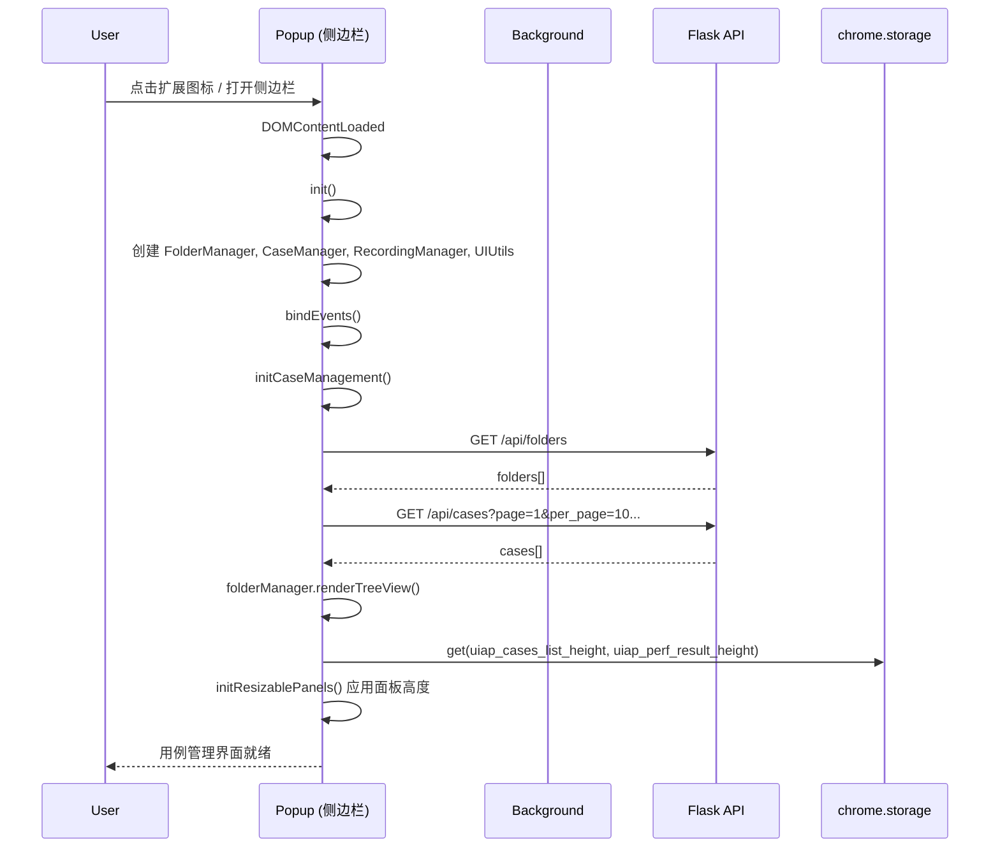
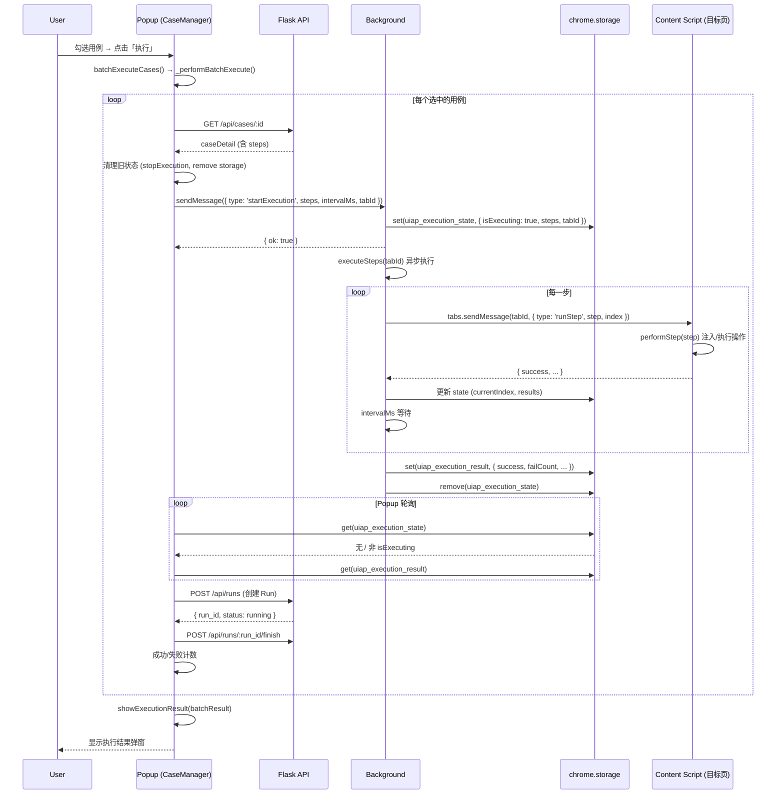
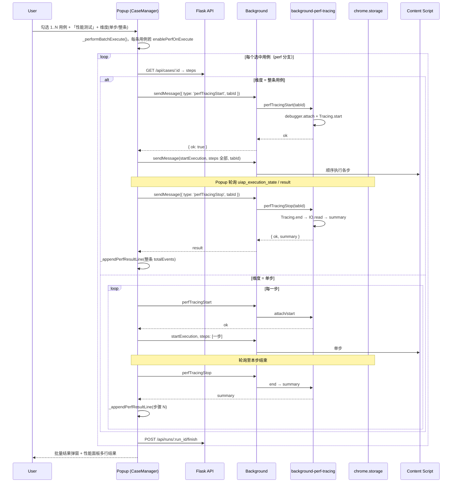
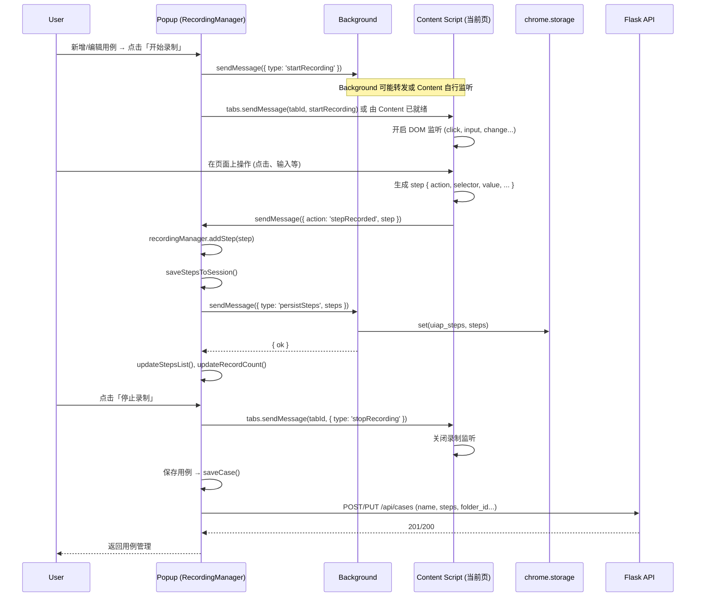
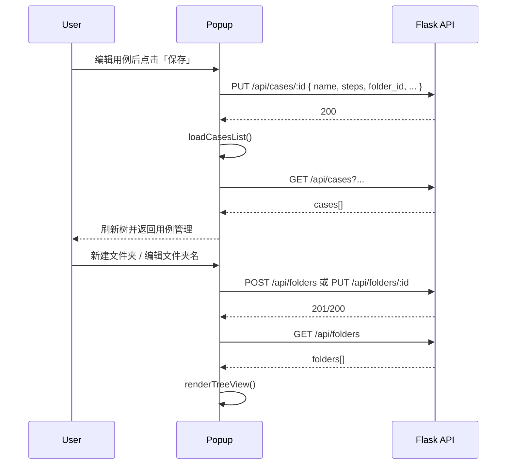
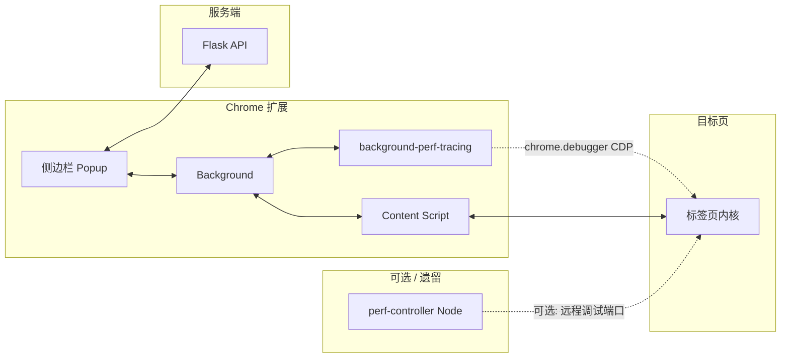

# 项目运行时序图

本文档用 Mermaid（及补充示意图）描述 **UI 自动化插件（侧边栏 + Background + Content）** 与 **Flask 服务端** 的主要运行时序。

**性能采集（Tracing）**：由扩展内 **`chrome.debugger` + CDP** 在**当前执行的目标标签页**上完成，经 `background-perf-tracing.js` 实现。**不再**通过侧边栏调用外部 HTTP 服务。  
目录下的 **`perf-controller/`（Node）为可选、遗留方案**：通过远程调试端口连接 Chrome，与当前插件默认路径无关；详见该目录 `README.md` / `requirements.txt`。

---

## 性能采集时序（讲解文档，与当前实现对齐）

入口与主流程：

```
[用户点击录制 / 执行 / 性能相关按钮]
        |
        v
[Chrome 扩展侧边栏 Popup]
 (用例管理 + 录制 + 性能开关 / 手动启停 / 结果面板)
        |
        | 1. 录制用例 → 与 Content / Background 协作
        |    & 保存 steps 到 Flask /api/cases
        |
        | 2. 执行用例 → sendMessage(startExecution, tabId, steps)
        | 3. 性能（自动）：同 tabId 上 sendMessage(perfTracingStart / Stop)
        v
[插件 Background]
 (executionState & 跨页面调度；perf 消息转 background-perf-tracing)
        |
        | sendMessage(runStep + ping)
        v
[Content Script + automation-core/advanced]
 (点击/输入/滚动/导航等 DOM 操作)
        |
        v
[Chrome 目标标签页]
 (页面加载、JS、渲染、网络、V8 等)
        ^
        |    chrome.debugger：Tracing.start / Tracing.end + IO.read（流式 JSON）
        |
[background-perf-tracing.js]
 (attach → Tracing.getCategories / start → end → tracingComplete → summary)
        |
        v
  summary { totalEvents } ----> Popup 性能结果面板 (_appendPerfResultLine)
        |
        v
POST /api/runs 创建运行 → 每步/整条用例追加 perf-segments → POST /api/runs/:id/finish
        |
        v
[Flask]
        |
        v
Run 与性能分段持久化到 SQLite；GET /api/runs/:id/perf 可回读
```

---

### 维度一：单步（Per-Step）

对**每一条选中的用例**，逐步循环：**启动 Tracing → 执行该步 → 停止 Tracing → 写入一行结果**；步骤数为 N 则该用例内 N 次 Tracing 启停、N 条结果行。**支持多选用例**：按列表顺序对每个用例各跑一遍上述循环。

```
[用户勾选 1..N 用例 + 「性能测试」+ 选「单步」]
        |
        v
[侧边栏 CaseManager._performBatchExecute]
        |
        | 对每个 caseId：拉取详情、解析 steps
        | RunCoordinator.runCase(perfMode: 'step')
        |
        | 对当前用例每一步：
        |   sendMessage(perfTracingStart, tabId)
        v
[Background → background-perf-tracing]
 (debugger.attach + Tracing.start)
        |
        v
[同 tabId：startExecution, steps: [当前步]]
        |
        v
[Background → Content：单步执行]
        |
        v
[Popup 轮询 storage 直至本步结束]
        |
        | sendMessage(perfTracingStop, tabId)
        v
[Background：Tracing.end → IO.read → totalEvents]
        |
        v
[_appendPerfResultLine(用例名, 步骤 N, totalEvents)]
        |
        v
RunCoordinator.finishRun('passed' | 'failed' | 'error')
        |
        v
(下一用例重复；用例间隔约 1s)
```

---

### 维度二：整个用例（Whole-Case）

对**每一条选中的用例**：**一次** Tracing.start → **一次** `startExecution`（全部 steps）→ **一次** Tracing.stop 汇总。**支持多选用例**，每条用例独立一整段 Tracing。

```
[用户勾选 1..N 用例 + 「性能测试」+ 选「整个用例」]
        |
        v
[CaseManager → RunCoordinator.runCase(perfMode: 'case')]
        |
        | sendMessage(perfTracingStart, tabId)
        v
[Background → Tracing.start]
        |
        | sendMessage(startExecution, steps 全部, intervalMs)
        v
[顺序执行全部步骤 → 轮询 storage 结束]
        |
        | sendMessage(perfTracingStop, tabId)
        v
[Tracing.end → summary]
        |
        v
[_appendPerfResultLine(用例名, 整条, totalEvents)]
        |
        v
RunCoordinator.finishRun('passed' | 'failed' | 'error')
```

---

## 1. 插件与页面启动



---

## 2. 执行用例（无性能采集）



---

## 3. 执行用例（带性能采集，可多选）

勾选 **「性能测试」** 时，`perfEnabled === true`，**不再**要求仅选中一条用例；对每个选中用例按维度（单步 / 整条）交给 `RunCoordinator.runCase({ perfMode: 'step' | 'case' })`。每段 Tracing 结束后通过 `POST /api/runs/:run_id/perf-segments` 持久化，最终 `POST /api/runs/:run_id/finish` 写入终态并更新用例统计。Tracing 经 **Background** 内 `perfTracingStart` / `perfTracingStop` 消息驱动，作用于 **`tabId`（当前活动标签页）**。



---

## 4. 录制步骤



---

## 5. 保存 / 加载用例与文件夹



---

## 6. 组件概览与消息流向



- **Popup**：用例树、录制面板、执行与「性能测试」开关、维度（单步/整条）、手动开始/停止采集、结果展示、可拖拽面板高度；与 Flask 拉取/保存用例与文件夹。
- **Background**：`startExecution` / `stopExecution`、执行状态写入 storage、向目标 tab 的 Content 发 `runStep`；**转发** `perfTracingStart` / `perfTracingStop` 至 `background-perf-tracing.js`。
- **background-perf-tracing**：在同一 `tabId` 上 `chrome.debugger` + CDP Tracing，返回 `summary.totalEvents`（不经过 Node）。
- **Content**：目标页 DOM 自动化与录制上报。
- **Flask**：用例与文件夹 CRUD、执行记录接口。
- **perf-controller（可选）**：独立 Node 服务，历史上用于 HTTP 触发 Tracing；**当前插件默认流程不依赖**，仅在你自行对接远程调试工作流时使用。
